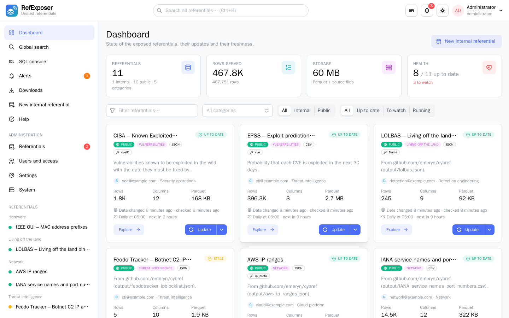
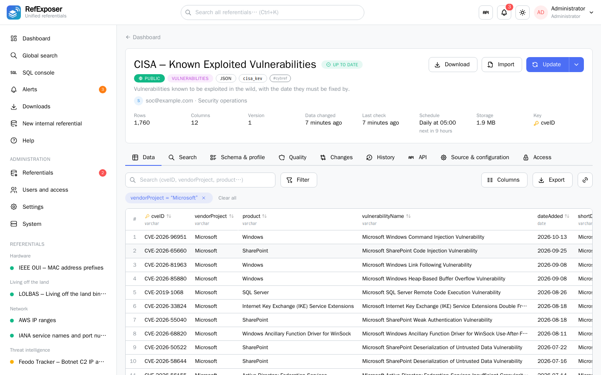
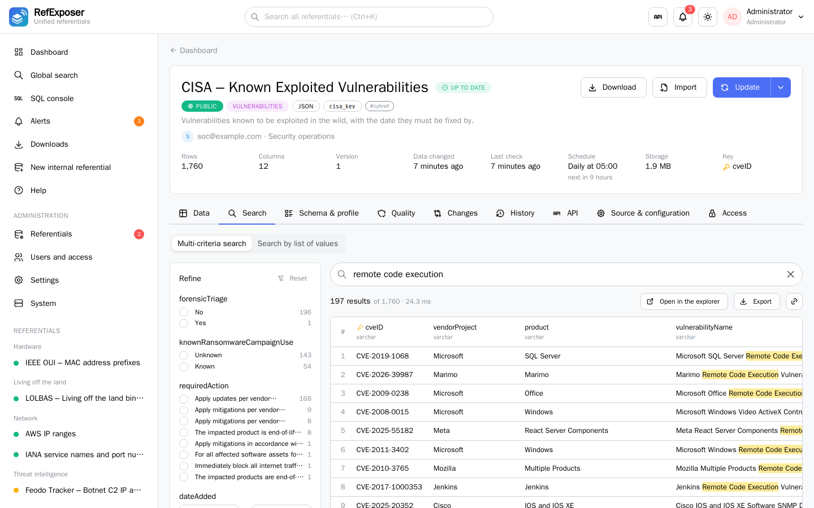
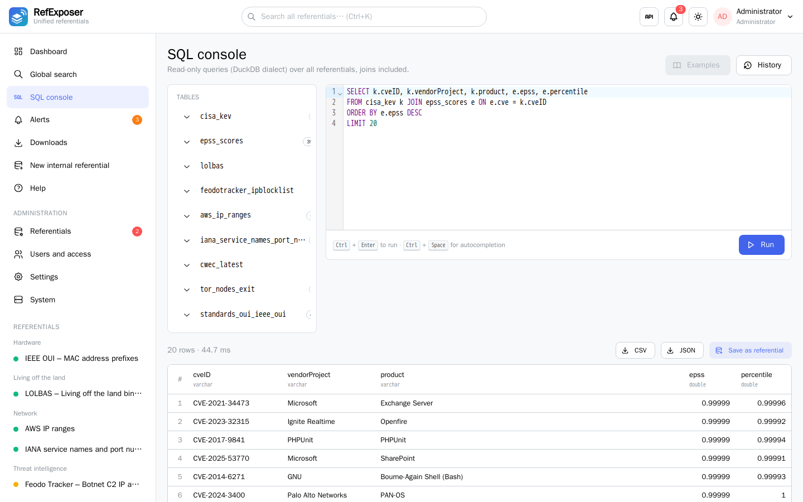
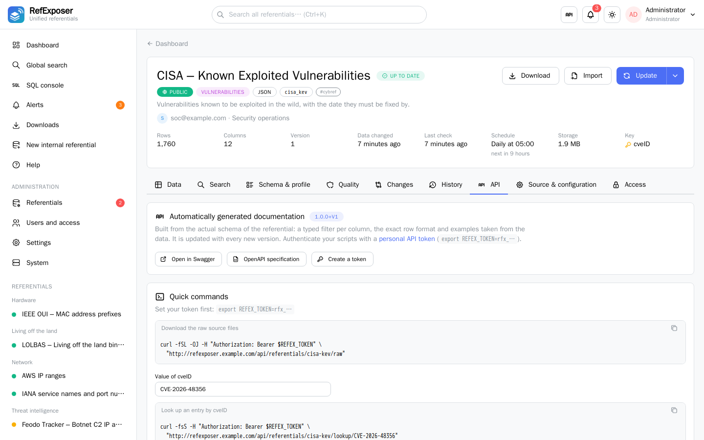
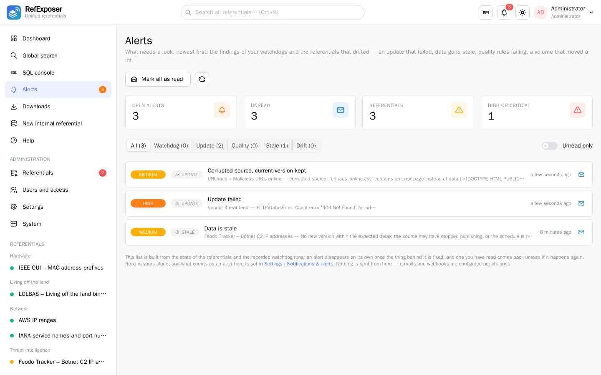

<p align="center"></p>

# RefExposer

[](https://github.com/emeryn/RefExposer/actions/workflows/ci.yml)
[](LICENSE)
[](backend/requirements.in)
[](frontend/package.json)
[](docs/README.md)

One tool to **expose, monitor and query heterogeneous referentials** (CSV, TSV, JSON, JSON Lines, TXT, XML, Parquet, Excel, SQLite, Bloom filters, MaxMind DB / GeoIP), whether they are downloaded from the Internet, dropped as files, or maintained directly in the application.

Declare a referential once — a URL, a Git repository, an uploaded file, or rows you type in — and RefExposer downloads it, normalizes it to Parquet, checks the new version and publishes it. From then on it is a web explorer, a documented REST API, a set of downloads and an SQL table, all at once, with the same rights everywhere.

## Screenshots

|  |  |
|---|---|
| <br><sub>**Dashboard** — every referential with its freshness, volume, owner and visibility.</sub> | <br><sub>**Explorer** — typed filters per column, with the schema, the profile and the changes beside them.</sub> |
| <br><sub>**Search** — full text plus facets computed from the data, or a list of 10,000 values at once.</sub> | <br><sub>**SQL console** — read-only DuckDB over the referentials you may read, joins included.</sub> |
| <br><sub>**API** — documentation generated from the actual schema, with ready-to-run commands.</sub> | <br><sub>**Alerts** — what needs a look: watchdog findings, failed updates, stale data, drifts.</sub> |

## What you get

Every published referential is available in four ways:

- **a web interface**: dashboard, explorer with filters and column profiles, differences between versions, history, SQL console (administrators and advanced users), global search, and built-in user and administrator guides;
- **a REST API documented automatically**: an OpenAPI specification generated from the schema of each referential — one typed filter per column, real examples, filters, search, single and batch lookups, exports;
- **downloads** of the whole version (CSV, CSV.gz, Excel, JSON, JSONL, Parquet, original source files), cached per version with a SHA-256 fingerprint;
- **read-only SQL** (DuckDB), joins between referentials included.

Beyond a downloaded file:

- **[Internal referentials](docs/internal-and-unified.md#internal-referentials)** maintained inside RefExposer (row editor, file loads, write API), for the lists your teams keep themselves.
- **[Unified referentials](docs/internal-and-unified.md#unified-referentials)** built from other referentials — rows put together, rows enriched with the columns of others, or any query of the SQL console kept as a referential and rebuilt when its sources move.
- **[Sync folder](docs/referentials.md#sync-folder)** and **[manual imports](docs/referentials.md#manual-imports)**: a file pushed by `rsync` becomes a referential; a version can be uploaded when the source is unreachable.
- **[Deltas](docs/referentials.md#deltas-merging-new-data-into-a-referential)**: a feed of the last 48 hours merged into the published data, instead of replacing it.
- **[Quality rules](docs/data-governance.md#data-quality)** checked on every version, with a score and a gate that rejects a bad one — and **corrupted sources are refused** rather than published.
- **[Kept versions](docs/data-governance.md#kept-versions-time-travel-saved-states-and-restore)**: keep each published version, or save a state before touching something — then compare any two of them, **restore** one, or **freeze** the referential so nothing updates it.
- **[Governance and personal data](docs/data-governance.md)**: who answers for a referential, whether it holds internal or public data, and columns of personal data **masked everywhere** unless someone entitled asks for them explicitly.
- **[Alerts](docs/monitoring.md), [notifications](docs/monitoring.md#notifications-e-mail-webhooks) and [watchdogs](docs/assistant.md#watchdogs-scheduled-investigations)**: one list of what needs a look, e-mails and webhooks per channel, and the assistant investigating on its own over a scope you choose.

Access is protected: [local accounts, LDAP / Active Directory or OpenID Connect](docs/users-and-rights.md#ldap-directory-openid-connect-and-access-approval) with group synchronization and mandatory approval, [roles and rights per referential](docs/users-and-rights.md#rights-per-referential), [two-factor authentication](docs/users-and-rights.md#two-factor-authentication), [service accounts](docs/users-and-rights.md#service-accounts) for tools, API tokens, an audit log, a [secret manager](docs/operations.md#secret-manager) for the credentials of the sources, and [confidential referentials](docs/data-governance.md#confidential-referentials) encrypted at rest. The whole picture is in [Enterprise security](docs/security.md).

## Quick start

Docker Engine 24+ with Compose v2.24+ (or Docker Desktop), about 2 GB of RAM and a few GB of disk.
Rootless Podman works too: see [Deployment](docs/deployment.md#run-with-podman-quadlet-rootless).

```bash
git clone <repository url> refexposer
cd refexposer
cp .env.example .env && chmod 600 .env   # set REFEX_PUBLIC_URL, POSTGRES_PASSWORD, REFEX_SECRET_KEY, the admin account
docker compose up -d --build
docker compose ps                        # db, backend and frontend healthy; init-permissions Exited (0)
```

Open **http://localhost:8080** and sign in with the initial administrator — a new password is required at first sign-in.

| URL | Content |
|---|---|
| http://localhost:8080 | Web interface |
| http://localhost:8080/help | User and administrator guides |
| http://localhost:8080/api/catalog/docs | Generated documentation of the referentials (Swagger, `?ref=<id>` for one) |
| http://localhost:8080/api/docs | Full technical API documentation |

Then add a first referential, whichever way suits you: **Administration › Referentials › New referential** (URL, Git repository or uploaded file, with a live preview), a CSV file dropped into `sync/`, or `config/cybref.yml.sample` copied to `config/cybref.yml` for a set of ready-made cybersecurity referentials.

RefExposer starts empty, and an **HTTP/HTTPS proxy**, company certificate authorities and the **branding** are configured from the interface. The full procedure, with the folders, the permissions and how to update and back up, is in [Getting started](docs/install.md).

## Documentation

Everything is in **[docs/](docs/README.md)**, one page per subject:

| Run it | Put data in | Open it to your users | Watch it |
|---|---|---|---|
| [Getting started](docs/install.md) | [Declaring a referential](docs/referentials.md) | [Users, rights and authentication](docs/users-and-rights.md) | [Alerts and notifications](docs/monitoring.md) |
| [Deployment](docs/deployment.md) | [Formats and transformations](docs/formats.md) | [Search, downloads and the API](docs/api.md) | [Assistant and watchdogs](docs/assistant.md) |
| [Configuration](docs/configuration.md) | [Special and large sources](docs/sources.md) | [Governance, confidentiality, quality](docs/data-governance.md) | [Operations](docs/operations.md) |
| [Architecture](docs/architecture.md) | [Internal and unified referentials](docs/internal-and-unified.md) | [Enterprise security](docs/security.md) | [Development](docs/development.md) |

Building the images from your own registry, PyPI mirror and npm registry — including with nothing reachable at all — is in [`enterprise/`](enterprise/README.md).

## Project

- **Licence**: [Apache 2.0](LICENSE) ([NOTICE](NOTICE)).
- **Changes**: [CHANGELOG.md](CHANGELOG.md).
- **Contributing**: [CONTRIBUTING.md](CONTRIBUTING.md) and the [code of conduct](CODE_OF_CONDUCT.md).
- **Reporting a vulnerability**: [SECURITY.md](SECURITY.md).

> Administrators are trusted users: a source or an SQL transformation makes the server reach the network and the files, as a configuration file would. Only give the admin role to people who need it.
